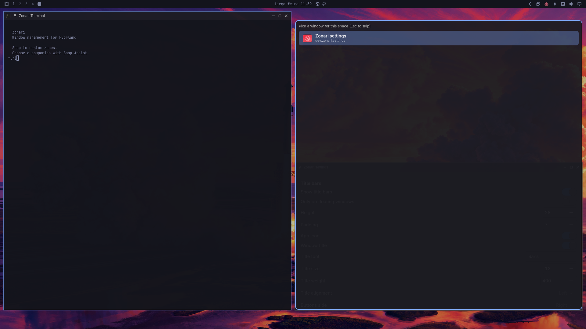
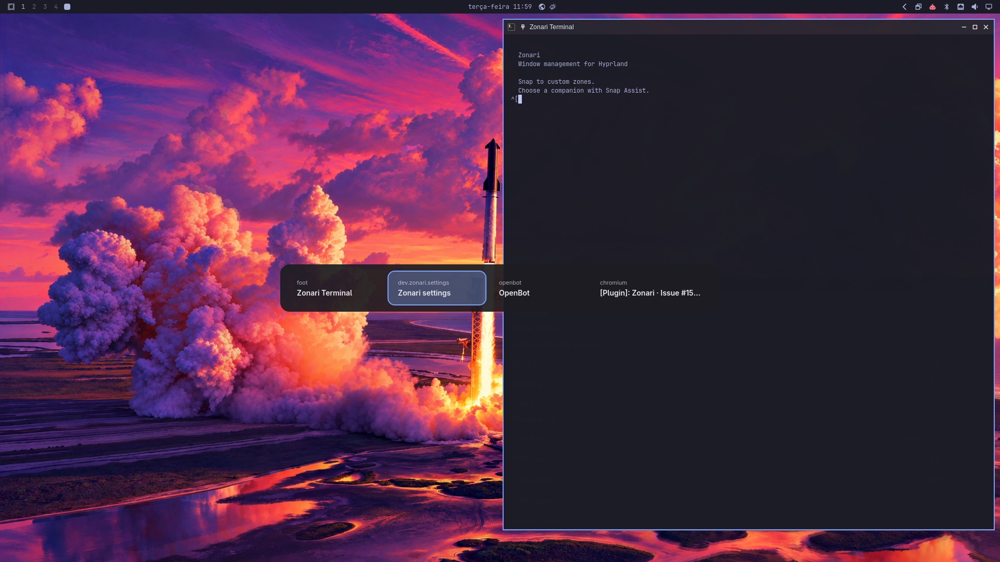
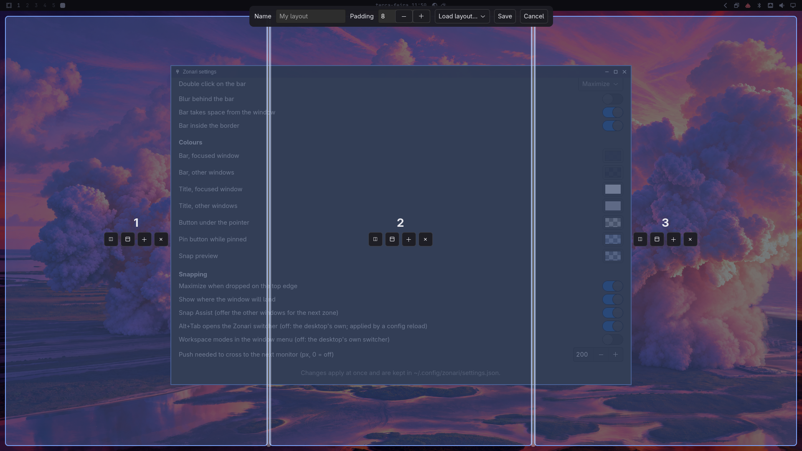

# Zonari

KWin-style window management for Hyprland: window snapping, custom zones, title bars, Snap Assist and an optional Alt+Tab switcher.

**Alpha.** Requires Hyprland's Lua configuration API and headers matching the compositor build. Hyprland 0.56.2 is tested live on Omarchy/Arch; 0.57.2 has build validation. Other distributions can build from source but have not been tested.

## Features

- Snap to halves, corners or custom layouts, including Shift-drag zones.
- Native title bars with window actions and a context menu.
- Snap Assist, keep above/below, show desktop and workspace policies.
- GTK settings, layout editor and optional Alt+Tab switcher.
- Omarchy bar widget and setup integration.

Application minimum sizes still apply. A window wider than a zone may overlap its neighbour; Zonari keeps it within the screen. Native plugins must be rebuilt after Hyprland updates.

## Screenshots

Real captures on Omarchy with Hyprland 0.56.2. Zonari's interface is shown in English.

**Snap Assist** — after snapping a window, choose another window for the empty zone.



**Alt+Tab** — the optional window switcher; disable it in settings to use Omarchy's switcher.



**Zone editor** — create custom snapping layouts.



[Title-bar settings](docs/images/settings.png) · [Snapping and switcher settings](docs/images/snapping-settings.png)

## Install

```sh
git clone https://github.com/lhenr1que/Zonari.git
cd Zonari
```

On **Omarchy**:

```sh
omarchy plugin add "$PWD" --enable
~/.config/omarchy/plugins/zonari/omarchy/zonari setup
hyprctl reload
hyprctl configerrors
```

On **other Hyprland distributions**:

```sh
bash scripts/install.sh
```

The source installer does not change your Hyprland config or load a plugin. Follow the [installation guide](docs/installation.md) to review and activate the generated example. The Omarchy setup manages its own config and offers an optional Alt+Tab replacement, which can also be disabled in settings.

## Documentation

- [Installation and removal](docs/installation.md)
- [Configuration and shortcuts](docs/configuration.md)
- [Architecture](docs/architecture.md)
- [Integration API](docs/api.md)
- [Troubleshooting](docs/troubleshooting.md)
- [Development and tests](docs/development.md)

## Repository layout

```text
crates/zonari-ui/   GTK4 UI (Rust workspace)
src/core/          Window-management policy (Lua)
src/bars/          Hyprland 0.57 title-bar plugin (C++)
src/bars-0.56/     Hyprland 0.56.2 title-bar plugin
omarchy/           Shell widget and setup wrapper
examples/          Hyprland Lua configuration examples
packaging/         Arch package recipes and rebuild hook
scripts/           Build, install and test helpers
tests/             Integration and regression tests
docs/              User and contributor guides
```

## Development

```sh
bash scripts/check.sh
```

See [CONTRIBUTING.md](CONTRIBUTING.md) and [CHANGELOG.md](CHANGELOG.md).

## License

Zonari is licensed under [GNU GPL version 3](LICENSE) (`GPL-3.0-only`). The title-bar plugins derive from hyprbars and retain their BSD-3-Clause notices. See [COPYRIGHT.md](COPYRIGHT.md) for attribution.
